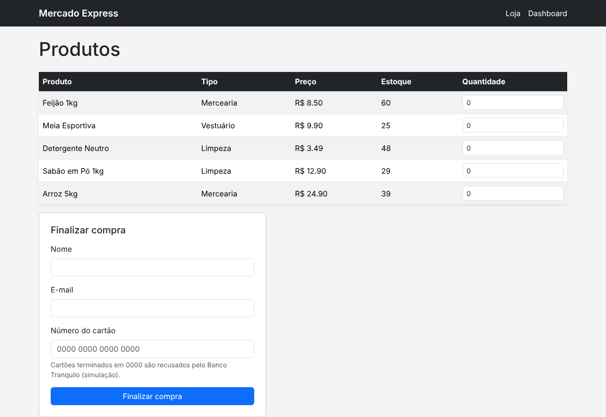
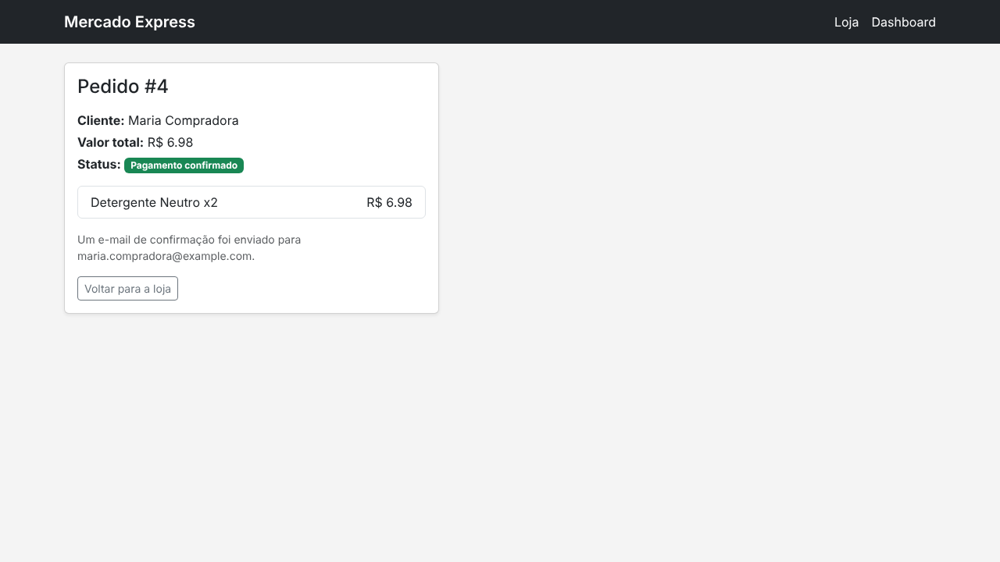
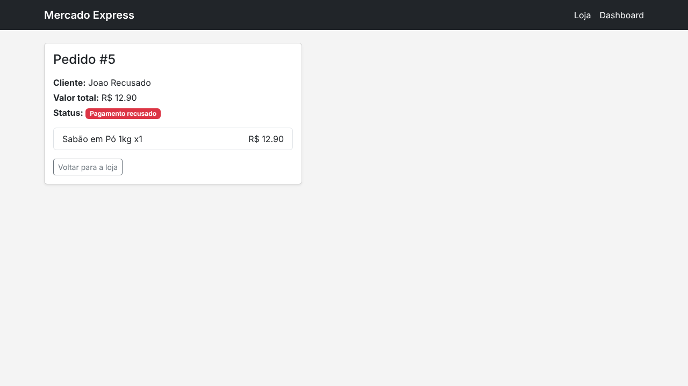
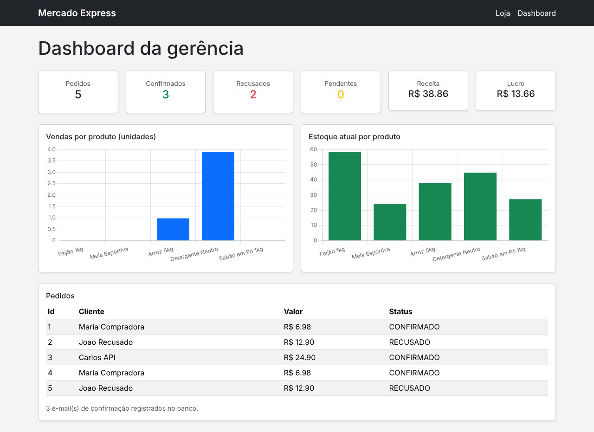

# Mercado Express - Mensageria

Trabalho de Checkpoint 5 (Parte 2 - Microsserviços com RabbitMQ, API do Banco Tranquilo e e-mail) da disciplina de TDS, FIAP, sob orientação do professor Dr. Marcel Stefan Wagner.

Este projeto simula a integração de pagamentos do Mercado Express: uma compra feita na loja é processada de forma assíncrona através do RabbitMQ, que troca mensagens entre o back-end do Mercado Express e a API do Banco Tranquilo (instituição parceira fictícia descrita no enunciado). Quando o pagamento é confirmado, um e-mail de aviso é enviado ao cliente e o envio fica registrado no banco de dados.

## Integrantes

- Nicolas Monteiro Ramiro - RM 562380
- Marcus Vinicius Vila Nova da Silva - RM 558771
- Hebert Lopes dos Santos - RM 563192

IDE utilizada no desenvolvimento: **IntelliJ IDEA**.

Link do video: Link do vídeo: https://youtu.be/p5rEKQWcWsE?is=Nq35S3s46llxyU43

## Tecnologias utilizadas

- Java 17
- Spring Boot 3.3.4, com os módulos Web, Thymeleaf, Data JPA, AMQP (RabbitMQ) e Mail
- Maven
- Lombok
- PostgreSQL, acessado via Spring Data JPA
- RabbitMQ, como broker de mensageria
- Chart.js, para os gráficos do dashboard
- Bootstrap 5, para o layout das telas

## Arquitetura

O fluxo segue o diagrama do enunciado: o front-end Web (ou uma chamada direta via Postman) envia a compra para o back-end, que grava o pedido como `PENDENTE` e publica uma solicitação de pagamento numa fila do RabbitMQ. Um consumidor processa essa fila, chama a API do Banco Tranquilo e publica a resposta numa segunda fila. Um segundo consumidor lê essa resposta, atualiza o status do pedido e, se aprovado, dispara o e-mail de confirmação.

```
Loja (Web) / Postman
        |
        v
  Back End API  --publica-->  fila.solicitacao.pagamento
        ^                              |
        |                              v
        |                     Integração de Pagamentos
        |                              |
        |                       chama a API do
        |                       Banco Tranquilo
        |                              |
 fila.resposta.pagamento  <--publica-- +
        |
        v
  Atualiza o pedido + envia e-mail de confirmação
```

**Exchange e filas no RabbitMQ:**

| Elemento                     | Tipo             | Routing key          |
|-------------------------------|------------------|------------------------|
| `mercadoexpress.pagamentos`   | Direct exchange  | -                      |
| `fila.solicitacao.pagamento`  | Queue            | `pagamento.solicitar`  |
| `fila.resposta.pagamento`     | Queue            | `pagamento.resposta`   |

**API do Banco Tranquilo:** como é uma instituição fictícia do enunciado, a API foi simulada dentro do próprio projeto, em `POST /banco-tranquilo/pagamentos`. Ela aprova o pagamento, exceto quando o número do cartão termina em `0000` (usado para demonstrar o fluxo de recusa).

## Estrutura de dados (PostgreSQL)

| Tabela                       | Descrição                                                        |
|-------------------------------|--------------------------------------------------------------------|
| `TDS_MSG_TB_MERCADO`          | Produtos do mercado (nome, tipo, preço, custo, estoque)            |
| `TDS_MSG_TB_PEDIDO`           | Pedidos (cliente, valor total, status: PENDENTE/CONFIRMADO/RECUSADO) |
| `TDS_MSG_TB_ITEM_PEDIDO`      | Itens de cada pedido                                               |
| `TDS_MSG_TB_EMAIL_ENVIADO`    | Registro de todo e-mail de confirmação enviado (ou tentado), para controle |

As tabelas são criadas automaticamente pelo Hibernate na primeira execução, e os produtos de exemplo são inseridos automaticamente pela aplicação (`ProdutoSeeder`).

> Conforme o enunciado pede, a configuração do banco de dados usado aqui foi enviada separadamente ao professor da disciplina Java Advanced.

## Endpoints

| Rota                              | Método | Descrição                                         |
|-------------------------------------|--------|------------------------------------------------------|
| `/`                                | GET    | Loja (tela com o carrinho de produtos)                |
| `/comprar`                         | POST   | Finaliza a compra feita pela tela da loja             |
| `/pedidos/{id}`                    | GET    | Acompanha o status de um pedido                       |
| `/api/pedidos`                     | POST   | Cria um pedido via API (JSON) - ver exemplo abaixo    |
| `/api/pedidos/{id}`                | GET    | Consulta o status de um pedido via API                |
| `/banco-tranquilo/pagamentos`      | POST   | API simulada do Banco Tranquilo                       |
| `/dashboard`                       | GET    | Dashboard gerencial com os pedidos e gráficos         |

### Exemplo de requisição de compra (JSON)

Arquivo [`requisicao-exemplo.json`](requisicao-exemplo.json), para usar no Postman ou Insomnia em `POST /api/pedidos`:

```json
{
  "clienteNome": "Maria Compradora",
  "clienteEmail": "maria.compradora@example.com",
  "numeroCartao": "4111111111111234",
  "itens": [
    { "produtoId": 1, "quantidade": 2 }
  ]
}
```

A resposta é imediata, com o pedido em status `PENDENTE` - o processamento do pagamento acontece de forma assíncrona pela fila. Consultando `GET /api/pedidos/{id}` alguns instantes depois, o status já aparece atualizado para `CONFIRMADO` ou `RECUSADO`.

A coleção pronta para o Postman está em [`mercado-express-mensageria.postman_collection.json`](mercado-express-mensageria.postman_collection.json), com os quatro testes: compra aprovada, compra recusada, consulta de status e chamada direta à API do Banco Tranquilo.

## Telas

### Loja



### Pedido confirmado



### Pedido recusado



### Dashboard da gerência

Mostra o total de pedidos, confirmados, recusados e pendentes, a receita e o lucro apurados, gráficos de vendas por produto e de estoque atual, e a lista de pedidos:



## E-mail de confirmação

O envio é feito via SMTP (compatível com qualquer provedor, testado com a Brevo) através do `spring-boot-starter-mail`. Cada tentativa de envio - com sucesso ou falha - é registrada na tabela `TDS_MSG_TB_EMAIL_ENVIADO`, incluindo a mensagem de erro quando aplicável, para que a falha de um envio nunca interrompa a confirmação do pedido.

## Executando o projeto localmente

É necessário um PostgreSQL e um RabbitMQ acessíveis. O jeito mais simples é subir os dois com o `docker-compose.yml` incluído no projeto:

```
docker compose up -d
```

Isso disponibiliza o PostgreSQL em `localhost:5432` e o RabbitMQ (com o Dashboard de gerenciamento) em `localhost:15672` (usuário/senha padrão: `guest`/`guest`).

Em seguida, configure as variáveis de ambiente abaixo e execute a classe `MercadoExpressMensageriaApplication`:

- `DB_URL`, `DB_USER`, `DB_PASSWORD` - conexão com o PostgreSQL (padrão local já aponta para o banco do `docker-compose.yml`)
- `RABBITMQ_HOST`, `RABBITMQ_PORT`, `RABBITMQ_USER`, `RABBITMQ_PASSWORD` - conexão com o RabbitMQ (padrão local já aponta para o `docker-compose.yml`)
- `MAIL_USERNAME`, `MAIL_PASSWORD` - credenciais SMTP do provedor de e-mail
- `EMAIL_REMETENTE` - endereço de e-mail que aparece como remetente

Nenhuma credencial fica salva no código ou no repositório. Com tudo configurado, a aplicação sobe em `http://localhost:8084`.
